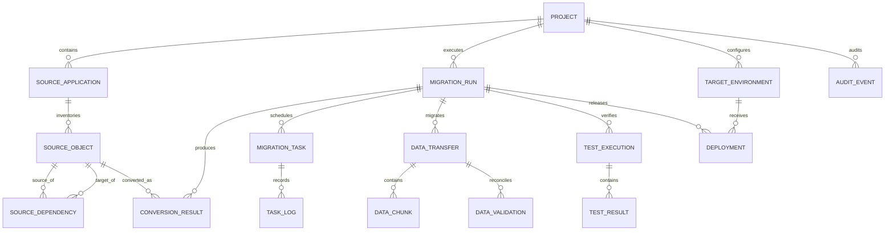

# APEX2NEXT — Framework ERD

The framework database stores migration metadata and execution evidence. It is distinct from the target business database generated for each migrated application.

## 1. Logical domains

- `platform`: projects, users, project memberships/configuration.
- `source`: source applications, objects, source artifacts.
- `analysis`: dependencies, inventory findings, complexity assessments.
- `conversion`: conversion rules, results, diagnostics, generated artifacts.
- `migration`: runs, tasks, task logs, data transfer/chunk checkpoints.
- `validation`: test executions/results and data reconciliation.
- `deployment`: target environments and releases.
- `audit`: append-only audit events.

## 2. Relationship model

## 3. Core entities

| Entity | Purpose | Key attributes |
|---|---|---|
| platform.project | Migration project | id, project_code, project_name, status |
| source.application | APEX app/source schema context | id, project_id, app_id, app_name, apex_version |
| source.source_object | Inventoried source asset | id, application_id, object_type, object_name, source_hash |
| analysis.dependency | Directed object dependency | id, source_object_id, target_object_id, dependency_type |
| conversion.result | Conversion outcome | id, run_id, source_object_id, target_type, status |
| conversion.diagnostic | Rule/parser/runtime finding | id, result_id, severity, diagnostic_code |
| migration.run | Immutable execution run | id, project_id, run_number, status, timestamps |
| migration.task | Durable unit of work | id, run_id, task_type, status, idempotency_key |
| migration.data_transfer | Table/object transfer | id, run_id, source_table, target_table, rows_migrated |
| migration.data_chunk | Transfer checkpoint | id, transfer_id, chunk_number, cursor_state, checksum, status |
| validation.data_validation | Reconciliation evidence | id, transfer_id, validation_type, source_value, target_value, status |
| validation.test_execution | Test suite execution | id, run_id, suite_name, status |
| validation.test_result | Individual test evidence | id, execution_id, test_key, status |
| deployment.target_environment | Target deployment config | id, project_id, environment_name |
| deployment.release | Release record | id, environment_id, release_version, status |
| audit.audit_event | Append-only activity record | id, project_id, actor_id, action, occurred_at |

## 4. Data modeling rules

- UUID primary keys; TIMESTAMPTZ for event timestamps.
- Foreign keys and unique constraints are mandatory for stable business identifiers.
- Use JSONB for source-specific metadata, parser payloads, and reconciliation values only when shape is genuinely variable.
- Store large exports/generated bundles in object storage; persist URI, hash, size, and retention metadata in PostgreSQL.
- Use soft deletion only for user-managed configuration. Execution evidence and audit records should be retained according to policy.
- Add indexes for project_id, run_id, status, created_at, and source object lookup paths.
- Dependency edges should be unique by source, target, and dependency type.
- Store source hashes and conversion rule-set versions to make regeneration reproducible.
